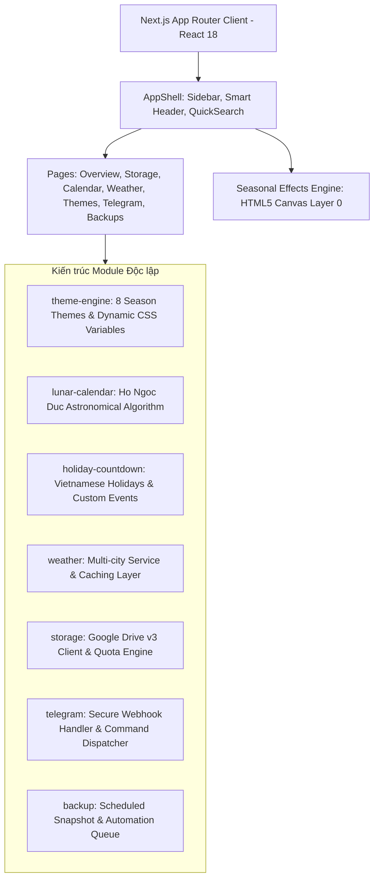

# DATAVAULT CLOUD HUB — KIẾN TRÚC HỆ THỐNG (ARCHITECTURE SPECIFICATION)

## 1. Giới thiệu & Sứ mệnh
DataVault Cloud Hub là nền tảng quản lý dữ liệu cá nhân cao cấp, kết hợp công nghệ điện toán đám mây hiện đại (Google Drive API v3, Telegram Bot webhook) cùng các giá trị văn hóa và tiện ích bản địa hóa (Lịch âm dương Việt Nam chính xác theo tọa độ thiên văn, Giờ Hoàng Đạo, Thời tiết thời gian thực và Giao diện 3D theo mùa).

---

## 2. Mô hình Kiến trúc Phân lớp (Layered Architecture)

---

## 3. Chi tiết Module Giai đoạn 1 (Phase 1)

### 3.1. Theme Engine
- **Cơ chế**: Không reload trang khi đổi giao diện. Toàn bộ mã màu, độ mờ glassmorphism và ánh sáng phát quang được cấu hình qua CSS Variables trong `globals.css` và `data-theme` attribute trên `<html>`.
- **8 Themes**:
  1. `spring-blossom`: Hồng hoa đào, ánh sáng dịu.
  2. `summer-nature`: Xanh lá rừng nhiệt đới, hổ phách ấm.
  3. `autumn-leaves`: Nâu sẫm espresso, lá phong cam đỏ.
  4. `winter-crystal`: Xanh sapphire băng tuyết, cyan.
  5. `cyber-3d`: Không gian số cyberpunk, neon cyan & hồng tím.
  6. `midnight-luxury`: Xanh đen hoàng gia, vàng kim hoàng tộc.
  7. `ocean-glass`: Đại dương xanh thẳm, ngọc lam.
  8. `minimal-pro`: Nền titanium đen tuyền, vô hiệu hóa hạt hiệu ứng.
- **Tùy chọn tự động**: Có thể kích hoạt chế độ đổi theme tự động theo tháng trong năm.

### 3.2. Seasonal Effects Engine
- **Nguyên tắc**: Sử dụng thẻ `<canvas>` độc lập với `pointer-events: none` đặt ở tầng dưới cùng (`z-index: 0`).
- **Tối ưu hóa hiệu năng**:
  - Không tạo DOM Node rác (Garbage Collection tối ưu bằng cách tái sử dụng Particle Pool).
  - Sử dụng `requestAnimationFrame`.
  - Tự động ngắt render khi tab bị ẩn (`document.visibilityState === 'hidden'`).
  - **Dynamic FPS Protection**: Nếu thời gian render khung hình > 45ms (< 22 FPS), hệ thống tự động giảm bớt mật độ hạt để giữ sự mượt mà cho giao diện.
  - Hỗ trợ `prefers-reduced-motion` và nút gạt Bật/Tắt hiệu ứng trực tiếp trên thanh điều hướng.

### 3.3. Lịch Âm Dương & Thiên Văn
- Sử dụng thuật toán chuyển đổi Julian Day (JDN) và tính toán kinh độ mặt trời theo chuẩn múi giờ GMT+7 của nhà toán học Hồ Ngọc Đức.
- Tính toán đầy đủ:
  - Ngày, tháng, năm âm lịch và tháng nhuận.
  - Can Chi của Ngày, Tháng, Năm (chu kỳ Lục thập hoa giáp).
  - 24 Tiết khí mặt trời (15° mỗi tiết khí: Xuân phân, Thu phân, Đông chí, Hàn lộ...).
  - Thập nhị thời thần (12 khung giờ) và 6 giờ Hoàng Đạo dựa trên Địa chi ngày (Ngọc Hạp Thông Thư / Lục Nhâm).
- Đã được kiểm chứng bằng Unit Test độc lập: `tests/unit/lunar.test.ts`.

---

## 4. Nguyên tắc Bảo mật (Security Guidelines)

Theo đặc tả tại Section 15 của dự án:
1. **Không rò rỉ Secret ở Client**: Tuyệt đối không đặt prefix `NEXT_PUBLIC_` cho các khóa như `TELEGRAM_BOT_TOKEN`, `DATABASE_URL` hay `GOOGLE_CLIENT_SECRET`.
2. **Không kết nối giả**: Ở Giai đoạn 1, trạng thái Google Drive và Telegram Bot hiển thị trung thực là `[CHƯA KẾT NỐI - CẦN CẤU HÌNH]`, không giả mạo đã kết nối API.
3. **Phân quyền Backend**: Khi kích hoạt Telegram bot tại Giai đoạn 6, kiểm tra Whitelist User ID ở tầng server trước khi xử lý bất kỳ câu lệnh nào.
4. **Validation**: Sử dụng Zod cho mọi dữ liệu đầu vào tại Route Handlers.

---

## 5. Quy trình Quản lý Nhánh Git

- `main`: Nhánh production ổn định.
- `develop`: Nhánh tích hợp chính.
- `feature/ui-dashboard`: Giai đoạn 1 (Foundation, Theme Engine, Master UI) — **Hoàn thành**.
- `feature/auth-database`: Giai đoạn 2 (Prisma, PostgreSQL, Auth).
- `feature/google-drive`: Giai đoạn 3 (Google Drive API v3 OAuth).
- `feature/lunar-calendar`: Giai đoạn 4 (Calendar Center & Personal Events CSDL).
- `feature/weather`: Giai đoạn 5 (Weather Service API & Cache).
- `feature/telegram`: Giai đoạn 6 (Telegram Bot Webhook).
- `feature/backup`: Giai đoạn 7 (Backup Snapshot & Automation Engine).
- `feature/production-hardening`: Giai đoạn 8 (Audits & Deployment).
